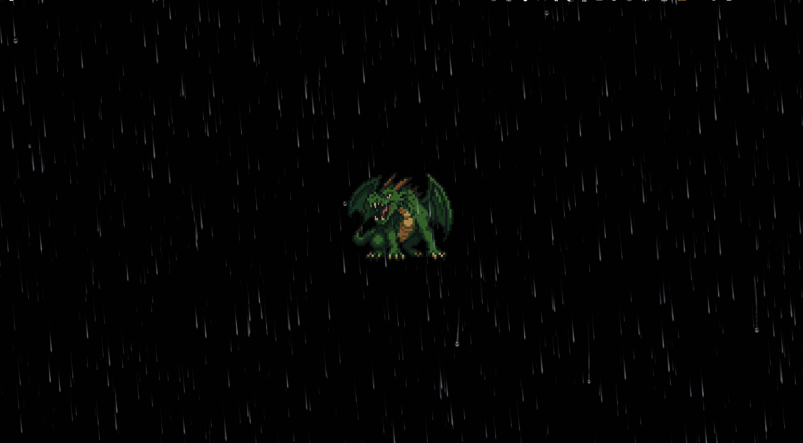
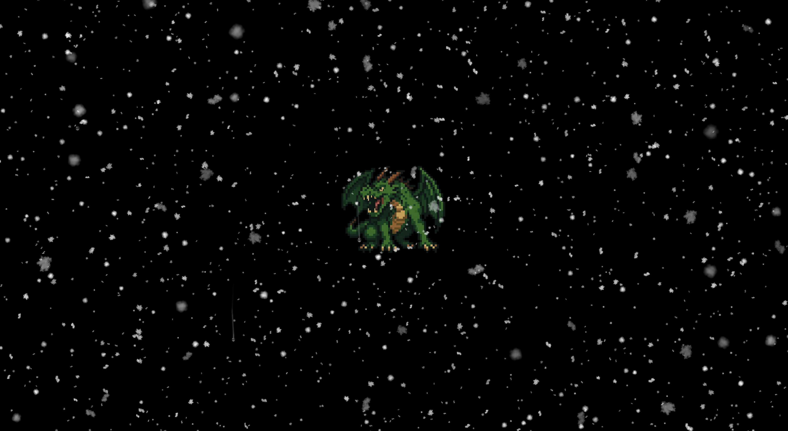
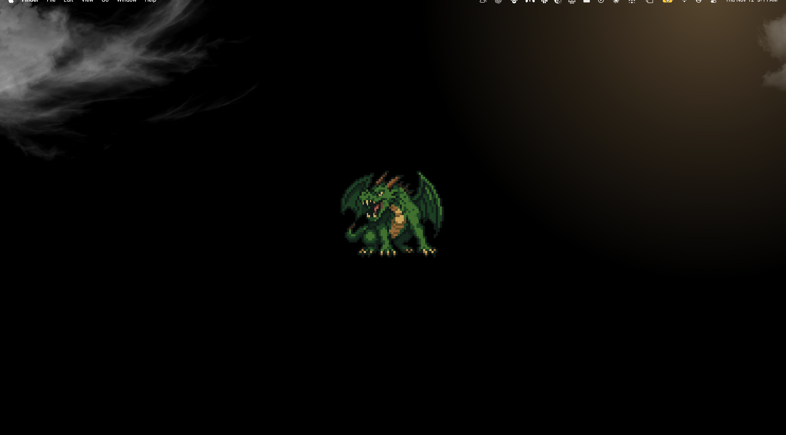

# Weather Wallpaper

Weather Wallpaper draws the current local weather over your macOS desktop wallpaper. Rain, snow, fog, clouds, and lightning appear above the wallpaper and below the desktop icons, on every display.

The app runs in the menu bar. It finds your location, gets the current conditions from [Open-Meteo](https://open-meteo.com), and updates every 15 minutes.

## Screenshots

The effects are animated. These screenshots show three of them over a dark wallpaper.

| Rain | Snow | Fog |
|---|---|---|
|  |  |  |

## Install

You need macOS 13 or later. The release packages are built for Apple silicon. On an Intel Mac, [build from source](#build-from-source).

1. Open the Releases page of this repository.
2. Download `WeatherWallpaper-vX.X.X.pkg` from the latest release.
3. Open the package.
4. Follow the installer steps.

The installer puts `Weather Wallpaper.app` in `/Applications` and starts it.

The package is not signed with an Apple Developer ID, so macOS blocks it the first time. If macOS blocks the package, open **System Settings > Privacy & Security**, scroll to **Security**, and click **Open Anyway**.

On first launch, macOS asks for permission to use your location. If you deny the request, the app estimates your location from your IP address through [ipapi.co](https://ipapi.co).

## Use the menu

Click the weather icon in the menu bar.

| Menu item | What it does |
|---|---|
| Effect | Shows live weather, or holds one effect that you choose. |
| Cycle All Effects | Shows each effect for 10 seconds, then restores your setting. |
| Refresh Now | Gets the current weather immediately. |
| Launch at Login | Starts the app when you log in. |
| Quit Weather Wallpaper | Stops the app and removes the effects. |

## Uninstall

1. Click the menu bar icon.
2. Select **Quit Weather Wallpaper**.
3. Move `/Applications/Weather Wallpaper.app` to the Trash.

## Build from source

You need the Swift 5.9 toolchain or later. Xcode or the Xcode Command Line Tools include it.

To build the app:

```sh
./build.sh
open "build/Weather Wallpaper.app"
```

To build the installer package:

```sh
./make-installer.sh
```

The script writes `build/Weather Wallpaper Installer.pkg`.

To show every effect in turn at startup, run the binary with `--demo`:

```sh
"build/Weather Wallpaper.app/Contents/MacOS/WeatherWallpaper" --demo
```

## Publish a release

A GitHub Actions workflow builds the installer package when you push a tag in the format `vX.X.X`. The workflow takes the app version from the tag, so you do not need to edit `Resources/Info.plist`.

```sh
git tag v0.2.0
git push origin v0.2.0
```

The workflow creates a GitHub release for the tag and attaches `WeatherWallpaper-v0.2.0.pkg`.
